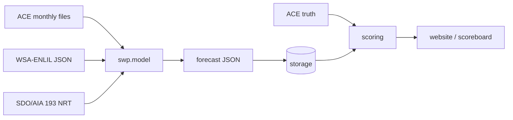

# Solar-wind speed forecasting: from competition entry to MLOps showcase

Live forecasts of ACE/SWEPAM bulk solar-wind speed, t0+1…72 h, every 6 h (FDL Benchlab tournament 2026).
The repo covers the whole path: data cut-offs enforced in code, a small blend model, honest evaluation, a container, a scheduled pipeline and a website.

**Status:** Phase 0 (foundation). See `docs/ROADMAP.md`.



## Layout
| Path | What |
|---|---|
| `src/swp/` | the package: live fetchers, `core()` (pure function), artifacts (blend + strip model) |
| `tests/` | offline tests: leak guards, ENLIL admission, fallbacks |
| `scripts/` | `replay_eval.py` (replay past cycles through the image and score them), exporters |
| `submission/` | the container as sent to the competition. Treat as frozen: change `src/`, not this |
| `research/` | the experiment code from the competition (features, ladder, bench scorer, Timestral, TCN). Not packaged |
| `docs/` | architecture, roadmap, experiment protocol |

## Quick start
```bash
python3 -m venv .venv && source .venv/bin/activate
pip install -e ".[dev]"          # add ,image for the AIA coronal-hole step
make test
make docker && make run T0=20261124T000000Z
```

## Data rules (enforced and tested)
- ACE: only labels ≤ t0 − 3 h. ENLIL: only runs started ≤ t0 − 12 h and ≤ 72 h old. AIA: images ≤ t0 − 1 h.
- Every layer has a fallback; the output always has 72 finite values.

Never commit `.team`, portal links, or data files (see `.gitignore`).
